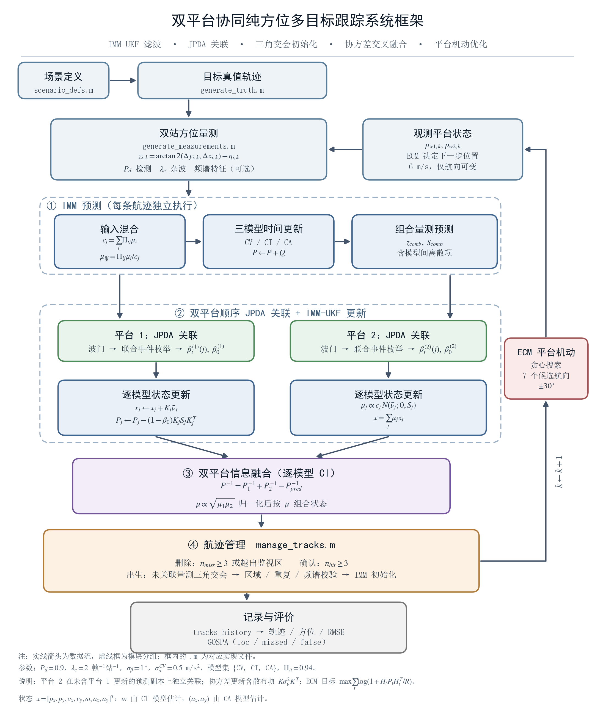

# Multitarget-Tracking · 双站协同机动多目标跟踪

双平台协同、方位量测（bearing-only）的机动多目标跟踪仿真平台，MATLAB R2024a 实现。



## 方法概要

- **IMM-UKF**：CV / CT / CA 三模型滤波，共用 7 维状态 `x = [px; py; vx; vy; ω; ax; ay]`，模型混合与融合都在这一状态空间内完成
- **JPDA**：多目标数据关联。波门与边缘关联概率由模型概率加权的组合预测（`z_comb`, `S_comb`）计算一次，各模型共用同一组 β 做条件更新
- **双平台融合**：两平台各自独立关联（平台 2 使用不含平台 1 更新的预测副本），再逐模型做协方差交叉（CI）融合，模型概率按归一化几何平均融合
- **航迹管理**：三角定位初始化新航迹；确认需连续 3 帧关联，删除需连续 2 帧丢失（双站 OR 检测下 `(1-Pd)² = 0.01`，误删概率约 1e-4）；每帧最多新建 1 条航迹以抑制鬼航迹
- **特征辅助（可选）**：LOFAR + DEMON 谱相似度作为 JPDA 似然的乘性项（`L_total = L_kinematic × L_feature`），特征不进入滤波状态；新航迹出生时要求两站谱型一致（DEMON 段 ρ ≥ 0.3 且 LOFAR 段 ρ ≥ 0.6）
- **ECM**：平台机动控制，在 7 个候选航向（±30°）中贪心选择，最大化一步期望信息增益 `Σ log(1 + HPHᵀ/R)`
- **GOSPA**：评价指标（p=2, c=100 m, α=2），可分解为定位误差 / 漏检 / 虚假航迹三部分

## 目录结构

```
matlab/     全部仿真代码（.m，扁平）
data/       舰船辐射噪声样本（wav 特征模式使用）
docs/       设计说明、系统框架图、实验记录
  figs/     框架图（SVG/PDF/PNG）与出图脚本
archive/    重构前的 .bak 回滚备份，代码不引用
CLAUDE.md   给 AI 编程助手的架构说明
```

`_diag/` 为本地一次性诊断脚本与结果缓存，已加入 `.gitignore`，不入库。

## 运行

在仓库根目录执行：

```bash
# 完整仿真（场景与特征开关在 matlab/main.m 顶部设置）
matlab -batch "addpath('matlab'); main"

# CV 单模型 vs IMM 的配对蒙特卡洛对比
matlab -batch "addpath('matlab'); compare_imm"

# 四套预设场景总览
matlab -batch "addpath('matlab'); run_scenarios"

# 杂波密度扫描
matlab -batch "addpath('matlab'); sweep_clutter"

# 两艘舰船 LOFAR+DEMON 频谱对比
matlab -batch "addpath('matlab'); compare_ship_spectra"

# 航迹管理配置的配对蒙特卡洛（默认 3 种配置 × 100 种子）
matlab -batch "addpath('matlab'); compare_track_mgmt"

# 4 场景 × 特征开/关 的回归扫描
matlab -batch "addpath('matlab'); compare_track_mgmt(struct('mode','sweep'))"
```

也可以先 `cd matlab` 再 `matlab -batch "main"`。在 MATLAB GUI 里只需 `addpath('matlab')` 一次。

## 实验结果

航迹管理参数对照（`speed` 场景、特征关闭、100 种子**配对**蒙特卡洛；同一种子下各配置面对完全相同的量测序列）：

| 配置（新增/确认/删除） | GOSPA (m) | loc (m) | false (m) | 航迹/帧 |
|---|---|---|---|---|
| 3 / 3 / 3（旧默认） | 124.9 ± 25.1 | 19.3 | 103.3 | 6.63 |
| **1 / 3 / 2（当前默认）** | **53.7 ± 33.3** | **12.6** | **38.3** | **4.04** |

90/100 个种子更优（符号检验 p = 2.9×10⁻¹⁵）；`speed` / `maneuver` / `parallel` / `crossing` 四个场景在特征开、关共 8 种组合下全部改善，无回归。

详细协议、分场景扫描与局限讨论见 [航迹管理参数优化实验记录](docs/航迹管理参数优化-实验记录.md)。

## 依赖

- MATLAB R2024a
- Statistics and Machine Learning Toolbox（`chi2inv`、`poissrnd`）
- Signal Processing Toolbox（`spectrogram`、`hilbert`、`butter`、`filtfilt`，仅 `use_features=true` 且从 wav 导入时需要）
- Python 3 + matplotlib（仅重新生成 `docs/figs/` 框架图时需要）

## 常用开关

| 参数 | 位置 | 说明 |
|---|---|---|
| `SCENARIO` | `matlab/main.m` 顶部 | `maneuver` / `parallel` / `crossing` / `speed` |
| `USE_FEATURES` | `matlab/main.m` 顶部 | `false` 退回纯方位模式，关闭全部特征路径 |
| `params.scenario` | `matlab/init_parameters.m` | 未在 `main.m` 覆盖时的缺省场景 |
| `params.use_features` | `matlab/init_parameters.m` | 特征辅助主开关 |
| `params.imm_models` | `matlab/init_parameters.m` | `{'CV'}` 为单模型基线，`{'CV','CT','CA'}` 为完整 IMM |
| `params.lambda_c` | `matlab/init_parameters.m` | 每帧每平台期望杂波数（默认 2） |
| `params.Pd` | `matlab/init_parameters.m` | 检测概率（默认 0.9） |
| `params.sigma_bearing` | `matlab/init_parameters.m` | 方位量测噪声标准差（默认 1°） |
| `params.max_new_tracks` | `matlab/init_parameters.m` | 每帧最多新建航迹数（默认 1） |
| `params.max_misses` | `matlab/init_parameters.m` | 航迹删除所需连续丢失帧数（默认 2） |
| `params.feature_gamma` | `matlab/init_parameters.m` | 谱相似度锐化因子（默认 8） |

## 文档

- [系统框架流程图](docs/系统框架流程图.md) — 单帧数据流、各环节与代码对应表、Mermaid 可编辑源码
- [航迹管理参数优化实验记录](docs/航迹管理参数优化-实验记录.md) — 配对 MC 协议、结果表、场景回归、局限与下一步
- [CLAUDE.md](CLAUDE.md) — 模块依赖、关键设计决策、全部调参项说明

## 数据路径约定

`data/` 下的 wav 文件一律通过 `matlab/repo_path.m` 解析为绝对路径：

```matlab
wav = repo_path('data', 'Cargo_40s.wav');
```

该函数从自身所在位置反推仓库根目录，与当前工作目录无关。**不要写成相对路径**——`generate_ship_spectrum` 在文件缺失时会回退到仿真频谱，路径写错会让特征实验在不知情的情况下失真（现已改为告警而非静默）。
