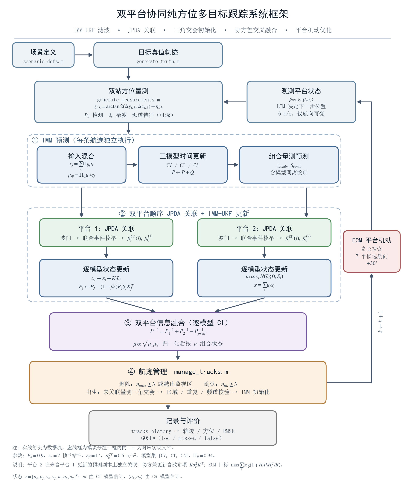
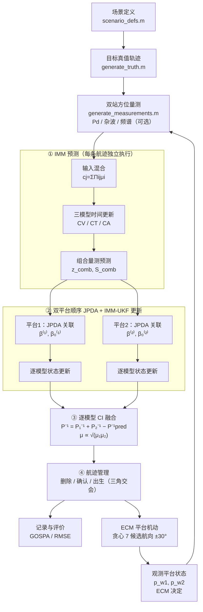

# 双平台协同纯方位多目标跟踪系统 — 框架流程图

按当前 `matlab/` 实现绘制（IMM-UKF + JPDA + 三角交会初始化 + 协方差交叉融合 + ECM 平台机动）。



## 产出文件

| 文件 | 格式 | 用途 |
|---|---|---|
| [figs/system_framework.svg](figs/system_framework.svg) | 矢量（文字已转路径） | Word / PowerPoint / Visio 插入，任意缩放不失真 |
| [figs/system_framework.pdf](figs/system_framework.pdf) | 矢量（内嵌 TrueType） | LaTeX `\includegraphics` |
| [figs/system_framework.png](figs/system_framework.png) | 300 dpi 位图 | 快速预览、不支持矢量的场合 |
| [figs/make_system_framework.py](figs/make_system_framework.py) | 生成脚本 | 改文字/配色后重新出图 |

成图物理尺寸 **18.3 cm × 21.9 cm**（竖幅）。

## 图元约定

| 图元 | 含义 |
|---|---|
| 实线箭头 | 数据流（本帧内的处理顺序） |
| 虚线圆角框 ①②③④ | 模块分组，不对应单独文件 |
| 方框内首行黑体 | 处理环节名称 |
| 方框内宋体 + 数学式 | 该环节的关键公式与实现文件 |
| 右侧红色回环 | 跨帧闭环：ECM 决定下一帧平台位置 → 影响下一帧量测 |
| `k ← k+1` | 时间步推进 |

## 各环节与代码对应

| 图中的块 | 实现 | 要点 |
|---|---|---|
| 场景定义 | [scenario_defs.m](../matlab/scenario_defs.m) | 4 种预置场景（maneuver / parallel / crossing / speed） |
| 目标真值轨迹 | [generate_truth.m](../matlab/generate_truth.m) | 分段 CV / CT / 切向变速，5 维真值 `[x,y,vx,vy,ω]` |
| 双站方位量测 | [generate_measurements.m](../matlab/generate_measurements.m) | `z=atan2(Δy,Δx)+η`，`Pd=0.9`，杂波 `λc=2`/帧/站，频谱可选 |
| 观测平台状态 | [platform_ecm_optimize.m](../matlab/platform_ecm_optimize.m) | 航速恒 6 m/s，ECM 只改航向 |
| ① 输入混合 | [imm_predict.m](../matlab/imm_predict.m) | `cj=ΣΠijμi`，`μi|j=Πijμi/cj`，混合初值含状态差项 |
| ① 三模型时间更新 | [build_motion_models.m](../matlab/build_motion_models.m)、[motion_ct.m](../matlab/motion_ct.m)、[motion_ca.m](../matlab/motion_ca.m) | 7 维状态 `[px,py,vx,vy,ω,ax,ay]`，CV 线性、CT/CA 走 sigma 点 |
| ① 组合量测预测 | [imm_measurement_predict.m](../matlab/imm_measurement_predict.m) | `S_comb=Σμj(Sj+Δzj²)`，含模型间离散项；强制 `S≥R` |
| ② 平台 1 / 平台 2 关联 | [jpda_associate.m](../matlab/jpda_associate.m)、[feasible_events.m](../matlab/feasible_events.m) | 波门 `ν²/S<χ²₀.₉₉(1)`，枚举可行联合事件，输出 `β` 与 `β₀`；平台 2 用**未含平台 1 更新**的预测副本 |
| ② 逐模型状态更新 | [imm_update.m](../matlab/imm_update.m) | 共用同一组 `β`；协方差含 `(1−β₀)KSKᵀ` 与散布项；`μj∝cjN(νj;0,Sj)` |
| ③ 双平台信息融合 | [ci_fuse.m](../matlab/ci_fuse.m) | `P⁻¹=P₁⁻¹+P₂⁻¹−P⁻¹pred`；非正定时退化为信息相加；`μ∝√(μ₁μ₂)` |
| ④ 航迹管理 | [manage_tracks.m](../matlab/manage_tracks.m)、[triangulate_init.m](../matlab/triangulate_init.m) | 删除 `n_miss≥3` 或出监视区；确认 `n_hit≥3`；出生为两站未关联量测三角交会 + 区域/重复/频谱校验 |
| ECM 平台机动 | [platform_ecm_optimize.m](../matlab/platform_ecm_optimize.m) | 7 个候选航向 `±30°`，最大化 `Σ log(1+HPHᵀ/R)`，带最小逼近距离惩罚 |
| 记录与评价 | [eval_gospa.m](../matlab/eval_gospa.m)、[gospar.m](../matlab/gospar.m)、[plot_results.m](../matlab/plot_results.m) | GOSPA（loc / missed / false 分解）+ RMSE + 6～7 张图 |

## 可编辑版本（Mermaid）

若只想在 Markdown 预览器里看结构、或需要快速改框图，可用下面的等价源码：



## 重新生成

```bash
python docs/figs/make_system_framework.py
```

- 依赖：`matplotlib`（3.10 已验证）+ 系统字体 SimHei / SimSun（Windows 自带）。
- 脚本内置**文字越界自检**：任何文字超出所属方框会打印 `[OVERFLOW] 框名: text x=(...) box x=(...)`。改完文字务必看这行输出，为 0 才算版式合格。
- 配色集中在脚本顶部的 `C_ENV / C_MOD / C_ASS / C_FUS / C_MAN / C_ECM / C_EVA` 字典；整体尺寸由 `SCALE`（1 逻辑单位对应的英寸数）控制，当前 `0.088`。
- 文字用黑体（框名）+ 宋体（说明）+ STIX（公式），符合学位论文插图习惯；若要全英文版，把各 `FontProperties(family=...)` 换成 Times New Roman、并把中文字符串替换即可。

## 插入论文的建议

- **推荐按 1:1 插入（宽 18.3 cm）**：此时框名 8.6 pt、说明 6.9～7.4 pt、脚注 6.4 pt，均在可读范围。
- 若版面只允许 16 cm 宽（A4 + 2.5 cm 页边距），缩放系数约 0.87，最小字号降到约 5.6 pt——仍可辨认，但建议把图放在单独一页、或把脚注 4 行移入正文/图注。
- 图注建议：
  > 图 x 双平台协同纯方位多目标跟踪系统框架。实线箭头为数据流，虚线框为模块分组；平台 2 在未含平台 1 更新结果的预测副本上独立完成关联与滤波，两站后验再经协方差交叉融合输出，平台机动由 ECM 闭环决定。
- 黑白打印时：四个分组框仍有填充灰度差 + 虚实线区分，可直接灰度出图；若要求纯黑白，把 `C_*` 的 `fc` 全改为 `"white"` 即可，靠边框与编号区分层次。

## 说明

本文档取代 [双平台协同跟踪多目标系统-设计计划.md](双平台协同跟踪多目标系统-设计计划.md) 中"系统架构 / 文件结构 / 主仿真循环"三节——那份计划描述的是早期单文件、4 维状态、固定平台的版本，与当前代码（7 维状态、IMM、移动平台、频谱可选）已不一致，保留仅作历史记录。
