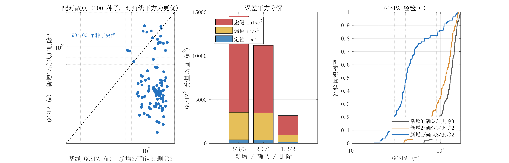

# 航迹管理参数优化（第一步）— 实验记录

> 结论先行：`max_new_tracks: 3 → 1`、`max_misses: 3 → 2`（`confirm_hits` 保持 3）。
> 100 种子配对 MC 下 GOSPA **124.89 → 53.70**（−57%），定位分量 **19.33 → 12.61 m**（−35%），
> 虚假分量 **103.29 → 38.33**（−63%），**90/100 个种子更优**，符号检验 **p = 2.9×10⁻¹⁵**；
> 4 场景 × 特征开/关共 8 种组合**全部改善，无回归**。

## 1. 改动

[init_parameters.m:113-124](../matlab/init_parameters.m#L113-L124)：

| 参数 | 原值 | 新值 | 作用 |
|---|---|---|---|
| `max_new_tracks` | 3 | **1** | 每帧最多新建 1 条航迹 |
| `max_misses` | 3 | **2** | 连续 2 帧丢失即删除 |
| `confirm_hits` | 3 | 3（不变） | 确认门槛不动 |

回滚：把这两个值改回 3 即可（`compare_track_mgmt.m` 的第一行配置就是原基线，可直接复现对照）。

### 为什么是这两个

上一轮诊断的结论是：特征关闭时性能崩塌**不来自滤波器**——用真值播种两条航迹并禁止新生，GOSPA 立刻回到 12.4 m，与特征开启的 14.6 m 相当；一旦放开出生，同样代码掉到 125 m。68 个新生航迹中 97% 距真实目标 >100 m，即两站杂波方位线的随机交点。

- `max_new_tracks = 3` 让这种“鬼航迹”几乎每帧都有名额补生；压到 1 后，真正的多目标只会延迟 1 帧出生（`speed` 场景的漏检分量 3.71 m 与改动前同为 3.71 m，说明没有误伤）。
- `max_misses = 3` 让鬼航迹多活一帧。双站 OR 检测下单帧“两站同时漏检”的概率是 $(1-P_d)^2 = 0.01$，连续 2 帧约 $10^{-4}$——真实航迹几乎不可能被这条规则误删，所以删除可以更激进。
- `confirm_hits` 单独调高会**反效果**（实验记录：3/5/3 配置下 GOSPA 159.5）：GOSPA 把“未确认航迹”计入漏检分量，延迟确认的代价大于压鬼的收益。必须和出生节流成组调。

## 2. 实验协议（配对蒙特卡洛）

`compare_track_mgmt.m` 的核心是**配对**而不是独立重复：

```
for seed = 1…100
    for config in {3/3/3, 2/3/2, 1/3/2}
        rng(seed);               % 每次运行前重置随机数
        run_simulation(cfg)      % 完整 100 步仿真
```

由于 `generate_measurements` 只依赖真值、检测概率与杂波实现，**与航迹数无关**，同一 `seed` 下各配置面对的是逐帧完全相同的量测序列（同一批检测、同一批杂波、同一批方位噪声），差异只可能来自航迹管理。因此可以做逐种子的配对差分，并用符号检验判断“更优”是否系统性成立。

- 场景：`speed`；特征：关闭；种子：`1:100`；每种子 100 步。
- 指标：`eval_gospa` 的时间平均及其 loc / missed / false 分解、末帧最近邻匹配的 RMSE、平均航迹数。
- 运行环境：MATLAB R2024a，约 215 s / 100 种子。

## 3. 结果（100 种子，特征关）

| 配置（新增/确认/删除） | GOSPA 均值±std | 中位数 | 90 分位 | loc | false | 航迹/帧 |
|---|---|---|---|---|---|---|
| 3 / 3 / 3（基线） | 124.89 ± 25.06 | 129.78 | 153.07 | 19.33 | 103.29 | 6.63 |
| 2 / 3 / 2 | 108.73 ± 30.49 | 113.94 | 147.58 | 18.15 | 84.48 | 5.24 |
| **1 / 3 / 2（采用）** | **53.70 ± 33.26** | **41.02** | **109.08** | **12.61** | **38.33** | **4.04** |

配对差分（相对基线）：

| 配置 | 平均差 | 更优种子数 | 符号检验 p |
|---|---|---|---|
| 2 / 3 / 2 | −16.15 ± 31.38 | 67/100（67%） | 9.7×10⁻⁴ |
| 1 / 3 / 2 | −71.19 ± 42.61 | 90/100（90%） | 2.9×10⁻¹⁵ |

读法：

- 只改 `max_misses`（2/3/2）有稳定但有限的收益（−16，67% 胜率）；**主要收益来自出生节流**（从 108.7 再降到 53.7）。
- 相对基线：GOSPA −57.0%，定位分量 −34.8%，虚假分量 −62.9%，平均航迹数 6.63→4.04（−39%）。
- 单种子（`rng(42)`）曾给出 135→31 的“更好看”的数字；100 种子均值是 125→54。**单次运行的收益被高估了约 1 倍**，这正是要跑 MC 的原因。



左：逐种子配对散点（对角线下方＝改动更优）；中：GOSPA² 的 loc/miss/false 分解（平方和可加）；右：GOSPA 经验 CDF（曲线越靠左越好）。

## 4. 回归检查（4 场景 × 特征开/关，10 种子）

| 场景 | 特征 | 基线 3/3/3 | 改动 1/3/2 | 变化 |
|---|---|---|---|---|
| speed | 关 | 129.42 | 51.83 | −60.0% |
| speed | 开 | 16.01 | 14.00 | −12.6% |
| maneuver | 关 | 115.60 | 60.54 | −47.6% |
| maneuver | 开 | 23.98 | 15.71 | −34.5% |
| parallel | 关 | 132.20 | 71.84 | −45.7% |
| parallel | 开 | 23.27 | 13.73 | −41.0% |
| crossing | 关 | 136.55 | 54.67 | −60.0% |
| crossing | 开 | 15.57 | 13.39 | −14.0% |

**8 个格子全部改善，没有回归**。特征开启时收益偏小是符合预期的——频谱一致性校验本来就在压制鬼航迹出生，出生节流与它是同一件事的两种做法，不叠加冲突。这说明该参数改动可以安全地设为默认值，不影响已有的特征辅助路径。

（10 种子只用于“方向是否一致”的回归判断，不做显著性声明。）

## 5. 局限与下一步

1. **这是“止血”，不是“修机制”**：改动只是把出生/删除的闸门拧小，没有解决“单帧交会即建航迹、无跨站一致性检验”的本质问题。残余的 38 m 虚假分量对应平均约 2 条已确认假航迹，仍需第二步处理。
2. **多目标扩展性**：`max_new_tracks=1` 在 $N$ 个目标同时出现时会让第 $N$ 条航迹延迟 $N-1$ 帧出生。当前 2 目标场景测不出代价，但 5 目标时建议改成动态配额（如首帧按未关联量测数分配），或直接由第二步的出生判据替代这个硬上限。
3. **指标口径**：GOSPA 把未确认航迹算作漏检，所以 `confirm_hits` 只能保持 3；若将来改用“只统计已确认航迹 + 单独报告暂定航迹数”的口径，可重新评估该参数。
4. **场景覆盖**：100 种子只覆盖 `speed`；其余场景各 10 种子。若要进论文正文，建议把 100 种子扩到全部 4 场景（约 15 min/场景）。

**第二步（下一步）**：在 `manage_tracks` 的出生环节加入不依赖特征的三重检验——几何协方差（由三角交会 Jacobian 计算 `P_init`，病态几何直接拒生）、双站联合门（$\nu_1^2/S_1+\nu_2^2/S_2<\chi^2_{0.99}(2)$）、M/N 时间一致性，并给新生航迹一个差分初速。目标是让特征辅助从“必需”降级为“加分项”。

## 6. 复现

```bash
# 100 种子配对对比（打印表格 + 出图 + 缓存结果）
matlab -batch "addpath('matlab'); compare_track_mgmt(struct('save_mat','mc_100.mat'))"

# 改图样式后重绘, 不必重跑 4 分钟仿真
matlab -batch "addpath('matlab'); compare_track_mgmt(struct('load_mat','mc_100.mat', ...
    'save_fig','docs/figs/track_mgmt_mc'))"

# 4 场景 × 特征开/关 回归扫描
matlab -batch "addpath('matlab'); compare_track_mgmt(struct('mode','sweep'))"

# 换场景 / 换种子数
matlab -batch "addpath('matlab'); compare_track_mgmt(struct('n_mc',50, ...
    'scenario','maneuver','use_features',false, ...
    'save_fig','docs/figs/mc_maneuver','save_mat','mc_maneuver.mat'))"
```

`cfg.mgmt` 可取任意 `[max_new_tracks confirm_hits max_misses]` 组合，用于论文里的参数消融表。
